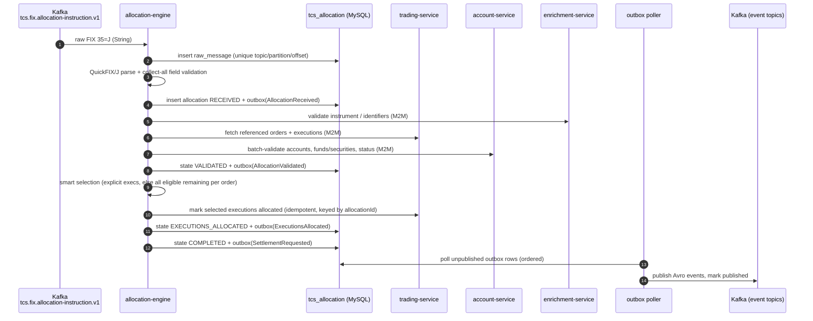
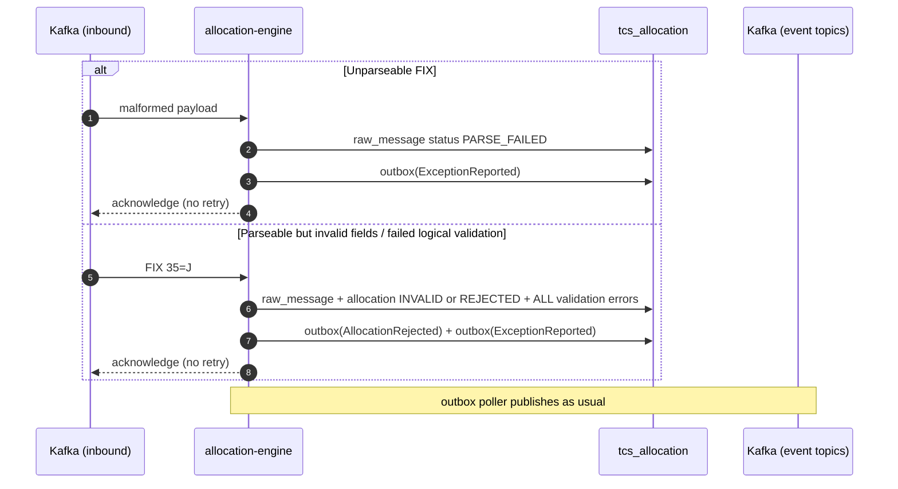
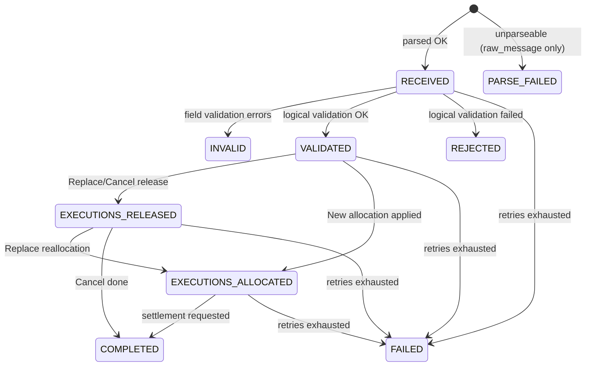

# Event Flows — Allocation Pipeline

Design target (Phases 7–8). Topics, envelope, and schema rules: `docs/contracts/event-catalog.md`.

## Happy path — New allocation

## Field-invalid / malformed input (permanent failures — never retried)

## Transient failure → retry topics → DLT

Downstream 5xx/timeout or DB unavailability throws; spring-kafka non-blocking retries redeliver via `…-retry-0/1/2` (exponential backoff 1s→16s, 4 attempts total), then `…-dlt`. Because every step commits state first and every step is idempotent (raw_message/allocation unique keys; trading updates keyed by allocationId), redelivery resumes from the persisted state instead of repeating side effects. Exhaustion → allocation state `FAILED` + `ExceptionReported`.

## Replace / Cancel

- **Replace:** validate as above → release executions of the referenced allocation in trading-service → `EXECUTIONS_RELEASED` + outbox(ExecutionsReleased) → select + allocate replacement set → `EXECUTIONS_ALLOCATED` + outbox(ExecutionsAllocated) → `COMPLETED` + outbox(SettlementRequested).
- **Cancel:** validate reference → release executions → `EXECUTIONS_RELEASED` + outbox(ExecutionsReleased) → `COMPLETED` (no settlement event).

## Allocation state machine (persisted on the allocation row)

Terminal: `PARSE_FAILED`, `INVALID`, `REJECTED`, `COMPLETED`, `FAILED`. A recovery job resumes non-terminal allocations after restart (crash-resume test required in Phase 8).

## Correlation & causation

`correlationId` flows inbound header → MDC → every log line → outbound REST header → outbox → event header + `EventMetadata.correlationId`. `causationId` = the raw message ID (first-level events) or the triggering event's `eventId`.
