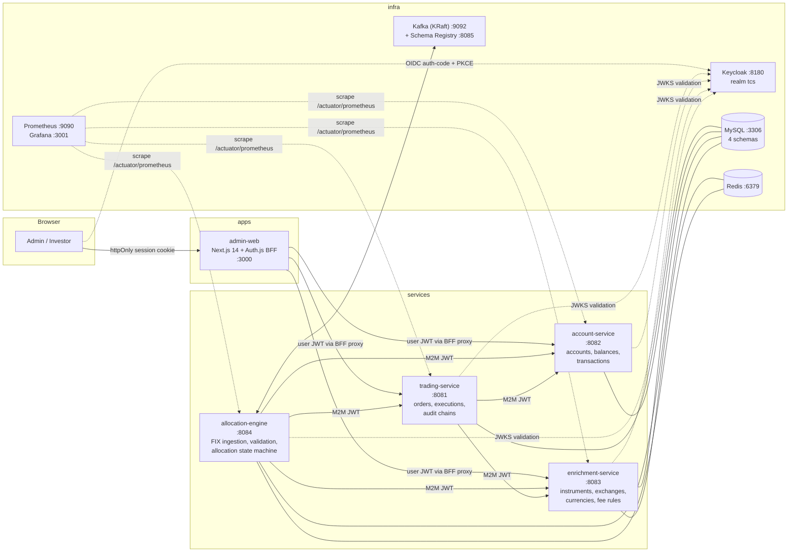

# Target Architecture

Approved 2026-07-14. This document describes the **target** state; `docs/status/current-status.md` records what exists today. Nothing here is a claim that a component is already implemented.

## System context

A distributed Trading Capture System: an admin/investor web application over four Spring Boot services, with an event-driven allocation pipeline ingesting FIX 4.4 AllocationInstruction messages from Kafka.



## Communication rules

- **Synchronous (REST/JSON, OpenAPI-documented):** browser → admin-web BFF (session cookie); BFF → services (user bearer token); allocation-engine → trading/account/enrichment and trading → enrichment/account (client-credentials M2M). All remote calls have explicit connect/read timeouts; allocation-engine's calls additionally get Resilience4j retry (exponential + jitter) and circuit breakers.
- **Asynchronous (Kafka):** inbound raw FIX allocation instructions; outbound versioned Avro domain events published via transactional outbox. Topic catalog and envelope: `docs/contracts/event-catalog.md`.
- **No API gateway** (ADR-0009). The BFF is the single browser-facing entry point; Kubernetes Ingress does path routing in-cluster.

## Security model (summary; full model doc arrives Phase 9)

Keycloak realm `tcs`: OIDC authorization-code + PKCE for `admin-web` (Auth.js, tokens server-side only, httpOnly encrypted session cookie), client-credentials for machine clients. Every service is an OAuth2 resource server validating issuer, audience, and scopes via JWKS. Realm roles `ADMIN`, `INVESTOR`; scopes `order:create|read|update|delete`, `execution:read|write`, `account:admin`, `account:balance`, `enrichment:read|admin`, `allocation:process`. Ownership checks (investor sees only owned orders) enforced in trading-service, never in the UI alone.

## Data & consistency

Schema-per-service on one MySQL instance with per-service DB users (ADR-0013); Flyway migrations own every schema change. No distributed transactions: the allocation engine uses a persisted state machine (ADR-0006) + transactional outbox (ADR-0005) + DB-authoritative idempotency with Redis pre-filter (ADR-0007). `BigDecimal`/`DECIMAL` for all money and quantities; `Instant`/`DATETIME(6)` UTC everywhere (ADR-0014).

## Observability

Structured JSON logs (Logstash encoder) with `correlationId` propagated HTTP → MDC → Kafka headers → consumer MDC (`libs/observability-support`); Actuator liveness/readiness probes; Micrometer → Prometheus → provisioned Grafana dashboards. No distributed tracing in scope (ADR-0015).

## Deployment model

- **Local/demo:** docker-compose (grows per phase: MySQL+Keycloak+Redis now; Kafka+Schema Registry at Phase 6; Prometheus+Grafana at Phase 11; app services as they become runnable).
- **Delivery artifacts:** per-service multi-stage Dockerfiles (non-root, HEALTHCHECK), plain Kubernetes manifests (namespace, Deployments, Services, ConfigMaps, Secret refs, probes, resource limits, Ingress), declarative Jenkinsfile. K8s/Jenkins are **validated** (kubeconform, Jenkins linter) — execution status is always reported honestly in `docs/release/final-verification.md`.

## Repository layout

```text
apps/admin-web              services/trading-service    libs/event-contracts     contracts/openapi
infrastructure/docker       services/account-service    libs/test-support        docs/{architecture,adr,contracts,
infrastructure/kubernetes   services/enrichment-service libs/observability-support   development,interview,plans,
infrastructure/jenkins      services/allocation-engine  scripts                      reference,release,status}
infrastructure/observability
```
